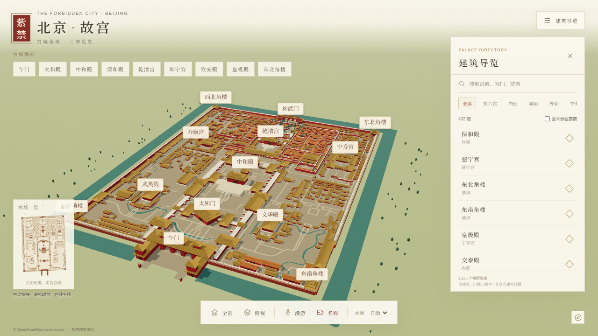

# 北京故宫 · 建筑群三维漫游

完整宫城建筑群的浏览器三维外观模型，使用 TypeScript、Vite 与 Three.js。以 OpenStreetMap 故宫宫界和建筑足迹组织建筑、门廊、院墙与台基，用故宫博物院公开建筑资料核对重点殿宇。



## 打开模型

在线地址：https://binbin52010.github.io/forbidden-city-3d/

本地使用 Node.js 22.18 或以上版本：

```powershell
cd "E:\AI游戏\故宫模型"
npm install
npm run dev
```

打开终端显示的本地地址，默认 http://127.0.0.1:4186/ 。

```powershell
npm run validate-model
npm run build
npm run preview
```

## 操作

- 鼠标左键拖动旋转、滚轮缩放、右键拖动平移。
- 手机单指旋转、双指缩放与平移。
- 点击建筑或中文导览条目查看形制、模型高度、资料可信度与来源；工具栏可恢复全景或俯视。
- “漫游”进入庭院地面：鼠标观察，WASD / 方向键移动，Shift 加速，Esc 退出。未获指针锁定时可按住鼠标拖动观察。
- “名称”控制地标标签；“画质”切换自动、高、低。性能按钮显示当前帧率、绘制批次与三角形数。

## 模型口径

范围为紫禁城城墙内建筑外观与周围护城河。数据使用 WGS84 转本地米坐标，X 向东、Z 向南、Y 向上。

地图要素分别包含建筑、墙体、宫门、塔楼、台基等，不代表故宫官方建筑总数。主殿、午门、角楼采用独立形制；近景叠加门窗、柱列、斗拱、台基栏杆和实例化瓦片。远景合并构件，按距离逐级显示细节。

用途为欣赏与科普。地图标签、建筑细节和尺寸存在不同程度的近似；缺少可靠尺寸的构件按同类建筑比例估算，并在建筑记录中保留可信度。植物位置为庭院景观示意。室内陈设不在此版本范围内。

原始地图快照、加工脚本、抓取时间和版本随仓库保存，详见 [资料来源](docs/SOURCES.md)。故宫官方网站仅用于核对事实与链接参考，模型材质与构件由程序原创生成。现有快照含 1,235 条建筑、城墙、宫门、塔楼、亭与台基记录；其中 9 个宫内闭合水面、25 条水道线与 10 个扩展范围内的水域多边形分开保存。

## 数据与署名

© OpenStreetMap contributors。原始 OSM 数据及其派生布局数据库使用 [ODbL 1.0](https://www.openstreetmap.org/copyright)；参见 public/data/LICENSE-ODbL.txt。数据署名也显示在模型界面。

从项目根目录再生成数据（需要网络连接访问 OSM API）：

```powershell
cd "E:\AI游戏\故宫模型"
python -m pip install -r tools/requirements.txt
python tools/fetch-data.py
npm run validate-model
npm run build
```

脚本会覆盖 `public/data/osm-source.json` 和 `public/data/palace.json`；运行前建议保留现有快照。公开地图更新后，模型要素数量可能变化。Python 3.9.13 与 Shapely 2.0.7 已用于本次快照。

## 验证与部署

`npm run validate-model` 校验宫界、唯一编号、数值、建筑分区、重点地标与几何；`npm run qa` 使用本机已安装的 Chrome，在独立测试进程中验证交互、碰撞、手机布局并保存截图。浏览器测试默认连接本地开发或预览服务；设置 `PALACE_URL` 可验证部署站点。

GitHub Actions 从 main 分支运行数据校验和生产构建，再发布到 GitHub Pages。生产页面与模型数据都是静态文件，使用相对资源路径。

`npm run qa:deployment` 实际访问在线页面，检查生产资源、模型载入、建筑点击及六宫院落，并保存 `docs/deployment-report.json` 和在线截图。

本次生产构建在本机 Chrome 中通过 25 项交互检查：测试地址为 `http://127.0.0.1:4187/`，桌面视口 1280 × 720，性能测量时使用自动画质；持续旋转测得 51 FPS，浏览器运行错误为 0。手机布局检查使用浏览器模拟视口。该结果仅描述本次测试环境，不能代表所有设备的帧率。验证截图位于 `docs/screenshots`，完整记录位于 [qa-report.json](docs/qa-report.json)。
